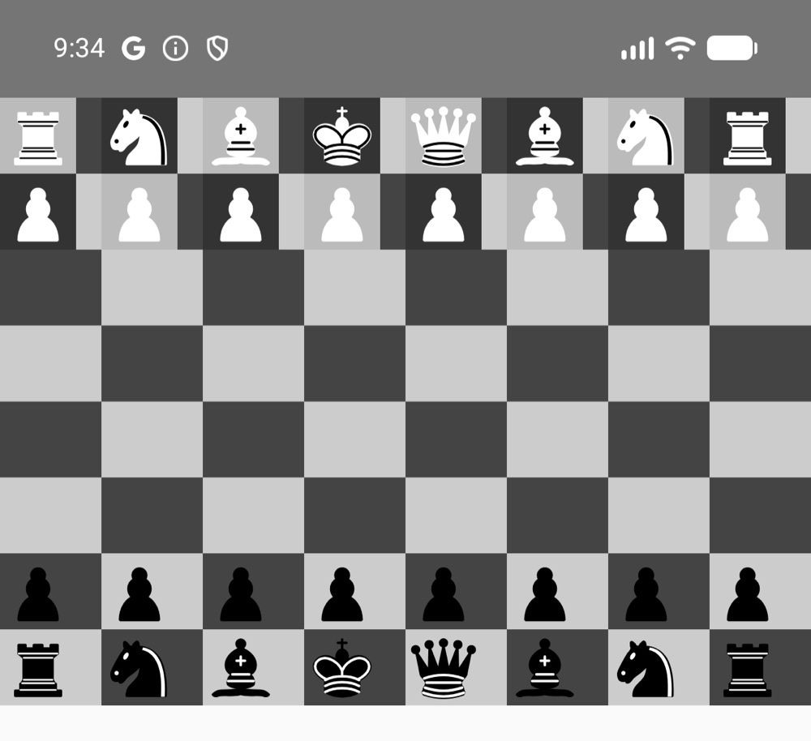
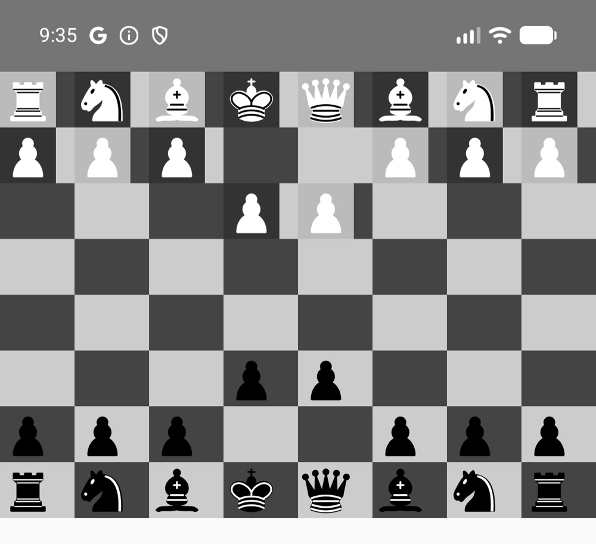
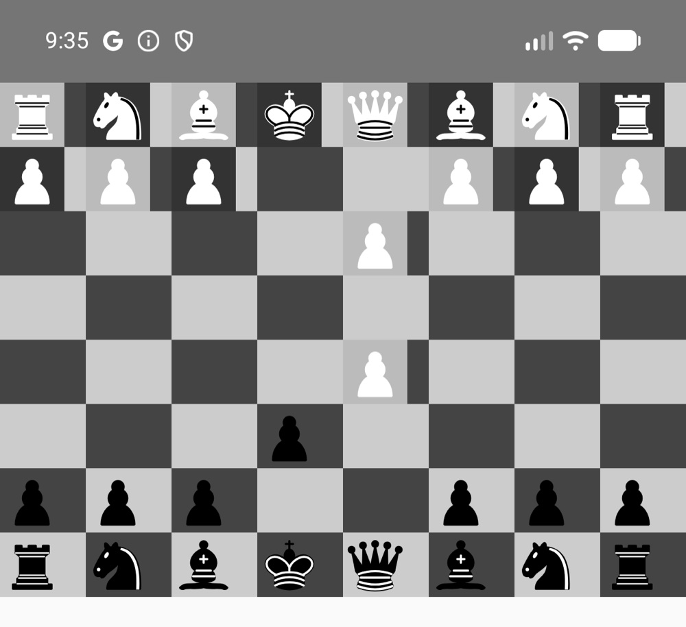

# Chess game using Compose Multiplatform

A chess board written once in Kotlin with Compose Multiplatform, running on Android and iOS.

## Screenshots

| Start | Mid-game | Capture |
|:---:|:---:|:---:|
|  |  |  |

- **Playing:** tap a piece, then tap the destination square.
- **Rules:** each piece type (pawn, rook, knight, bishop, queen, king) has its own move validation in `shared/src/commonMain/kotlin/domain/`.
- **Shared UI:** the board is a single Compose Multiplatform composable in `shared/src/commonMain/kotlin/App.kt`.
